# SOFTWARE REQUIREMENTS SPECIFICATION

## SMARTCOOK-MOBILE

**Ứng dụng trợ lý nấu ăn thông minh — Mobile, Web và Backend**

| Thông tin | Nội dung |
|---|---|
| Học phần | SDN302 + MMA301 |
| Học kỳ / mã dự án | FALL26 |
| Nhóm trưởng | Dinh Van Loi — QE190167 |
| Thành viên | Duong Anh Dao — QE190037 |
| Thành viên | Nguyen Van Quy — QE190031 |
| Thành viên | Nguyen Le Nhat — QE190011 |
| Giảng viên hướng dẫn | Huynh Vang |
| Địa điểm | Quy Nhơn |
| Mã tài liệu | SC-SRS-001 |
| Phiên bản tài liệu | 3.0 — bản rà soát |
| Ngày cập nhật | 06/10/2026 |
| Trạng thái | Dự thảo để nhóm và giảng viên rà soát; chưa ghi nhận phê duyệt |

Phiên bản 3.0 là phiên bản tài liệu, không phải phiên bản ứng dụng. Thông tin học phần và nhóm giữ theo bản nguồn. SRS tập trung vào mobile, đồng thời đặc tả web người dùng, web quản trị và backend dùng chung.

## Kiểm soát tài liệu

| Phiên bản | Thời điểm | Nội dung |
|---|---|---|
| Bản nguồn | 09/2026 | Danh sách 25 module và mô tả màn hình mobile. |
| 3.0 | 06/10/2026 | Chuẩn hóa phạm vi, yêu cầu, use case, flow, kiến trúc, dữ liệu, NFR, nghiệm thu và truy vết; bổ sung web/admin/chat/rewards; phân biệt code thật với UI/mẫu/hướng mở rộng. |

| Vai trò rà soát | Người / nhóm | Trạng thái |
|---|---|---|
| Nghiệp vụ, kỹ thuật và baseline | Nhóm SmartCook | Chưa xác nhận |
| Học thuật / nghiệm thu | Huynh Vang | Chưa xác nhận |

## Mục lục

1. Giới thiệu và quy ước
2. Tổng quan và phạm vi
3. Kiến trúc hệ thống
4. Yêu cầu chức năng
5. Use case và luồng nghiệp vụ
6. Dữ liệu và ERD
7. Giao diện và tích hợp
8. Yêu cầu phi chức năng
9. Quy tắc nghiệp vụ
10. Kiểm thử và nghiệm thu
11. Ma trận truy vết
12. Giới hạn và hướng mở rộng
13. Tham chiếu và sơ đồ

## 1. Giới thiệu và quy ước

### 1.1 Mục đích

SRS thống nhất hành vi cần có của SmartCook giữa nhóm phát triển, kiểm thử và người đánh giá. Yêu cầu phải có mã, phạm vi và điều kiện kiểm tra để truy vết đến màn hình, API, dữ liệu và nghiệm thu.

Cấu trúc tham khảo định hướng kỹ nghệ yêu cầu của ISO/IEC/IEEE 29148:2018. Tài liệu không tuyên bố đã được chứng nhận hoặc đánh giá tuân thủ toàn bộ tiêu chuẩn. Bản nguồn là đầu vào nghiệp vụ; mã nguồn hiện hành dùng để làm rõ phạm vi và khoảng cách triển khai. Sơ đồ cũ không thay thế bằng chứng vận hành production.

### 1.2 Quy ước

| Ký hiệu | Ý nghĩa |
|---|---|
| FR-xxx | Yêu cầu chức năng; “phải” diễn đạt hành vi bắt buộc trong phạm vi được chọn. |
| NFR-xxx | Yêu cầu phi chức năng có cách kiểm chứng. |
| BR-xxx / UC-xx / AT-xx | Quy tắc nghiệp vụ / use case / kiểm tra nghiệm thu. |
| P1 / P2 | Cốt lõi / bổ trợ hoặc tích hợp cần hoàn thiện. |
| Có mã nguồn | Có UI/API/service liên quan; không đồng nghĩa đã pass kiểm thử. |
| Một phần | Có một số lớp hoặc nền tảng; phần thiếu nêu tại mục 12. |
| Đề xuất | Yêu cầu mục tiêu chưa có đủ bằng chứng triển khai. |

Tiêu chí chấp nhận mô tả kết quả cần đạt. Trạng thái thực tế ghi ở mục 11–12. Các mục tiêu NFR chưa được đo trong lần rà soát tài liệu này.

### 1.3 Thuật ngữ

| Thuật ngữ | Định nghĩa |
|---|---|
| Recipe | Công thức: nguyên liệu, định lượng, bước nấu và dinh dưỡng. |
| Fridge / Inventory | Kho nguyên liệu riêng của user, gồm chilled/frozen/pantry. |
| Fridge match | Tỷ lệ nguyên liệu công thức khớp theo tên với nguyên liệu đang có. |
| Meal slot | Bữa sáng, trưa, tối hoặc phụ của một ngày trong tuần. |
| Shopping list | Danh sách mua sắm backend, có bought và syncedToFridge. |
| Local cart | Giỏ client, có vòng đời riêng; không mặc nhiên đồng bộ với backend cart. |
| DTO | Dữ liệu trao đổi/hiển thị; không phải collection độc lập. |
| XP / JWT / RBAC | Điểm kinh nghiệm / token xác thực / phân quyền theo role. |
| In-app notification | Thông báo database và Socket.IO khi app kết nối. |
| OS push | Thông báo qua dịch vụ push hệ điều hành; chưa hoàn thiện trong phạm vi hiện tại. |
| Fallback | Dữ liệu hoặc xử lý thay thế khi API/provider lỗi. |

## 2. Tổng quan và phạm vi

### 2.1 Bối cảnh và mục tiêu

SmartCook giúp người dùng chọn món, tận dụng nguyên liệu, theo dõi bước nấu, lập kế hoạch tuần, chuẩn bị mua sắm và chia sẻ với cộng đồng. Đối tượng gồm sinh viên, người đi làm, cá nhân sống một mình, gia đình và người quan tâm chế độ ăn. Đây là nhóm khách hàng, không phải các role kỹ thuật riêng.

| Vấn đề | Mục tiêu | Kiểm tra |
|---|---|---|
| Khó quyết định nấu gì | Tìm công thức theo danh mục, bộ lọc, kho và trợ lý AI. | AT-03, AT-04, AT-06 |
| Lãng phí nguyên liệu đang có | Quản lý kho và chỉ rõ nguyên liệu có/thiếu. | AT-04, AT-07 |
| Khó theo dõi quá trình nấu | Cooking Mode, timer và đọc hướng dẫn. | AT-05 |
| Kế hoạch và mua sắm rời rạc | Kết nối planner, shopping list và kho. | AT-07 |
| Thiếu tương tác/kiểm duyệt | Feed, chat và quản trị web. | AT-08–AT-11 |

Calories, giá tiền và kết quả AI là thông tin tham khảo. Phạm vi không bao gồm chứng nhận an toàn dị ứng, đo dinh dưỡng bằng xét nghiệm hoặc giá siêu thị thời gian thực.

### 2.2 Thành phần và tác nhân

| Thành phần | Trách nhiệm |
|---|---|
| smartcook-mobile | iOS/Android: tài khoản, survey, recipe, kho, scan, cooking, planner, cộng đồng/chat, profile, rewards và notifications. |
| smartcook-web | User portal, tuyến công khai và admin portal. |
| smartcook-backend | REST v1, auth/RBAC, nghiệp vụ, Socket.IO, MongoDB và provider. |
| Provider | Google Identity, Gemini, Cloudinary, SMTP; bản đồ trên thiết bị. |

| Tác nhân | Quyền |
|---|---|
| Khách | Web: giới thiệu, recipe, feed công khai, đăng ký/đăng nhập. Mobile main yêu cầu phiên. |
| User | Dữ liệu cá nhân, công thức/bài viết, bình luận, chat, scan, planner và rewards theo quyền. |
| Admin | User có role admin; truy cập web admin và API quản trị; không có collection Admin riêng. |
| Dịch vụ bên ngoài | Nhận yêu cầu theo giao diện tích hợp và cấu hình. |

### 2.3 Baseline và ngoài phạm vi

Baseline gồm tài khoản/survey; khám phá, chi tiết, favorite và tạo recipe; kho/fridge-match; scan/chat AI; Cooking Mode/history; kế hoạch tuần/shopping/stores; community/chat; profile/XP/rewards/in-app notifications; quản trị dữ liệu/tài khoản/nội dung/settings. Chức năng chỉ có API, UI hoặc mẫu ghi “Một phần”, không báo đã nghiệm thu.

Hướng mở rộng: mô hình đề xuất tự học, parser tìm kiếm NLP, planner tối ưu 14 ngày, bộ sưu tập recipe, nhật ký macros ăn thực tế, review nhiều tiêu chí, remix/AI generator lưu công thức đầy đủ, OS push khi app đóng, thanh toán/đặt hàng, voucher đối tác và đồng bộ offline tự động.

### 2.4 Giả định và phụ thuộc

Backend/MongoDB cần hoạt động để ghi bền vững. Camera/thư viện/GPS xin quyền khi dùng. Google login, OTP, media và AI cần cấu hình/provider hợp lệ; mẫu không thay thế kiểm thử tích hợp thật. Điểm danh hiện theo ngày UTC; tuần dùng weekStartDate chuẩn hóa, cần chốt múi giờ nghiệp vụ ở OI-03.

## 3. Kiến trúc hệ thống

### 3.1 Bối cảnh hệ thống

**Hình 1. SmartCook và các tác nhân bên ngoài.**

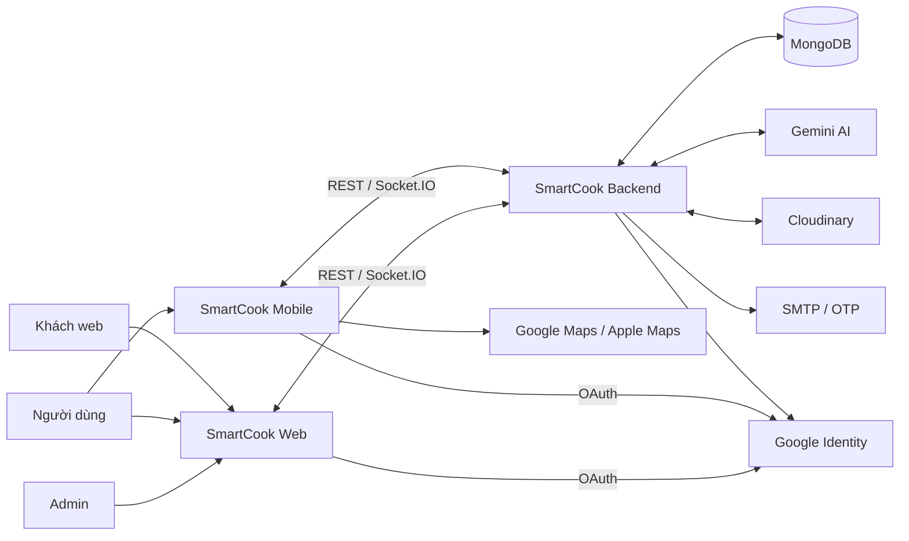

### 3.2 Kiến trúc tổng thể

**Hình 2. Tầng ứng dụng, dữ liệu và tích hợp.**

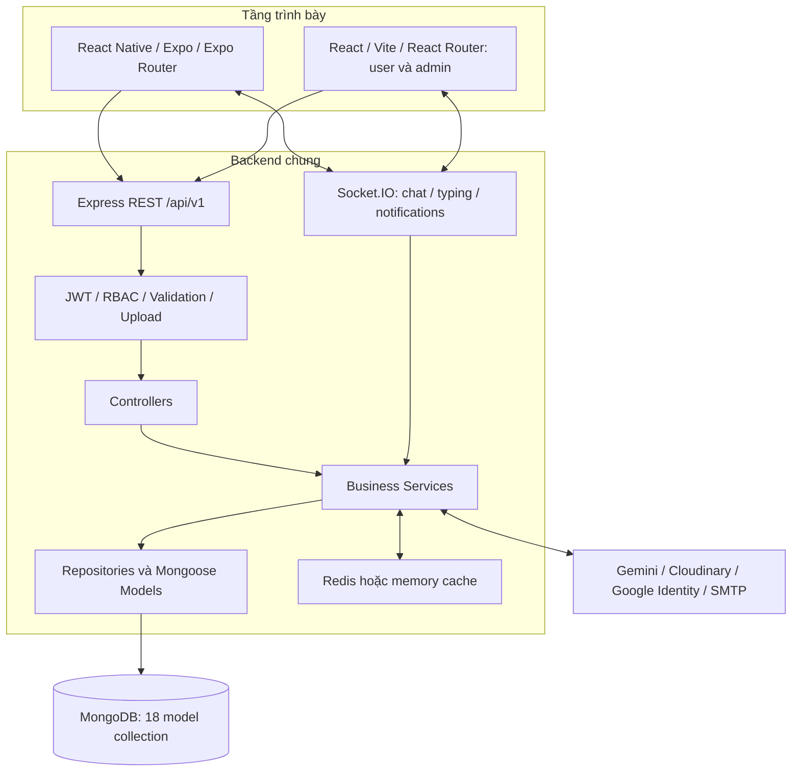

Backend dùng controller–service–repository/model; một số service truy cập model trực tiếp. Redis là cache, không phải persistence chính; không giả định có Redis adapter cho Socket.IO. HTTPS/WSS là yêu cầu production, trong khi URL dev có thể dùng HTTP.

### 3.3 Mobile

**Hình 3. Kiến trúc mobile rút gọn.**

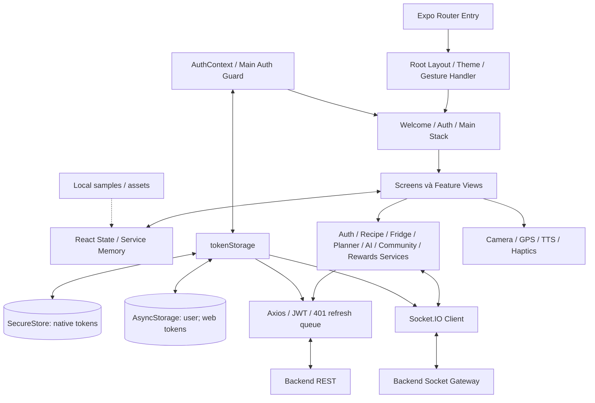

CartService mobile là memory cart; shopping list trong PlannerView gọi backend. Không mô tả chúng như một cart đã đồng bộ. AuthContext là nguồn phiên; PreferenceService cũ có state trong memory và không thay thế preferences trên server.

### 3.4 Web

**Hình 4. User/admin web dùng chung lớp tích hợp.**

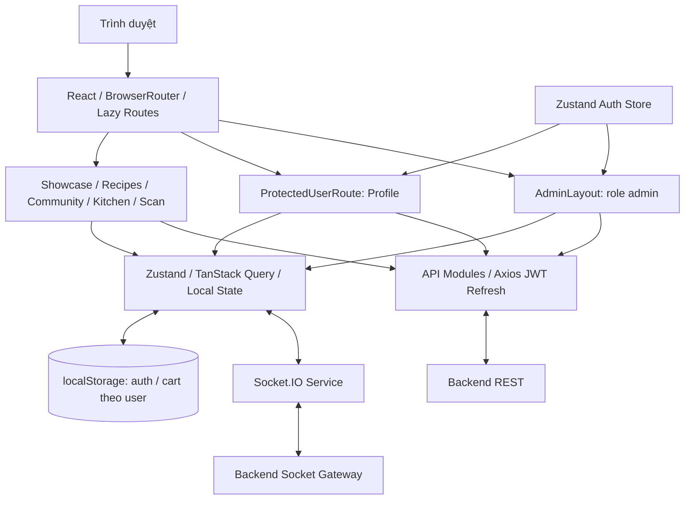

Kitchen/Scan trên web có tuyến công khai; thao tác dữ liệu riêng vẫn cần auth API. Không suy ra mọi page trong thư mục user đều có route guard. Marketing, hero banner và một phần approval dùng local state, xem G-08.

### 3.5 Công nghệ

| Tầng | Công nghệ theo manifest/config | Vai trò |
|---|---|---|
| Mobile | React 19, React Native 0.86, Expo SDK 57, TypeScript, Expo Router | Runtime, UI, navigation. |
| Mobile state/storage | Context/State, SecureStore, AsyncStorage | Phiên, state, cache profile. |
| Web | React 19, Vite 8, TypeScript, React Router, Tailwind CSS 4 | User/admin portal. |
| Web state | Zustand 5, TanStack Query 5 | State, truy vấn, cache. |
| Backend | Node.js, Express 5, TypeScript, Mongoose 9 | API, nghiệp vụ, truy vấn MongoDB. |
| Realtime/cache | Socket.IO 4.8; Redis/ioredis và memory fallback | Chat/thông báo; cache. |
| Provider | @google/genai, Cloudinary, google-auth-library, Nodemailer | AI, media, Google auth, OTP. |
| Kiểm tra/bảo vệ | Joi, JWT, bcryptjs, Helmet, rate limit, security middleware | Validation và truy cập. |
| Vận hành | Docker/Compose, Nginx config, Swagger, Winston/Morgan, test scripts | Build/hosting/docs/logging. |

Phiên bản major phản ánh manifest, không xác nhận production đang chạy. Runtime Node, MongoDB và TLS phải chốt theo môi trường triển khai, không lấy nhãn sơ đồ cũ làm bằng chứng.

## 4. Yêu cầu chức năng

Mỗi dòng là yêu cầu có thể kiểm chứng. API/trạng thái triển khai được truy vết tại mục 7 và 11. Tiêu chí là điều kiện cần đạt, kể cả những phần đang thiếu.

### 4.1 Tài khoản và khảo sát

| Mã / ưu tiên | Yêu cầu | Tiêu chí chấp nhận |
|---|---|---|
| FR-001 / P1 | Phải cho phép đăng ký bằng họ, tên, email, mật khẩu. | Họ/tên 1–50 ký tự, email hợp lệ, password 6–128 ký tự; email trùng bị từ chối; mobile quay về login sau thành công. |
| FR-002 / P1 | Phải xác thực tài khoản và khôi phục phiên hợp lệ khi mở app. | Sai thông tin/khóa account không cấp quyền; mobile vào Home hoặc survey theo hồ sơ. |
| FR-003 / P2 | Phải hỗ trợ Google login qua ID token. | Backend xác minh token trước cấp phiên SmartCook; hủy/lỗi OAuth có phản hồi. |
| FR-004 / P1 | Client phải refresh access token và kết thúc phiên khi refresh thất bại. | Request 401 được retry và queue được giải quyết; refresh sai/thu hồi xóa phiên, về login. |
| FR-005 / P1 | Phải cho phép logout phiên hiện tại. | Xóa tokens/profile cache; mobile main không vào được; backend thu hồi refresh token theo cơ chế hiện tại. |
| FR-006 / P2 | Phải hỗ trợ reset password qua email OTP. | OTP 6 số, hạn 15 phút; sai/hết hạn/đã dùng không đổi được; băm password mới, thu hồi refresh cũ. UI client còn thiếu. |
| FR-007 / P1 | Phải lưu survey gồm khẩu phần, ẩm thực, mục tiêu, hạn chế, khẩu vị, thời gian. | Lưu preferences; tải lại đúng lựa chọn; bỏ qua không chặn Home. |
| FR-008 / P1 | Phải cho phép sửa họ, tên, avatar. | Backend xác nhận; UI dùng response; tải lại giữ thông tin. Đổi email chưa thuộc profile endpoint. |

### 4.2 Công thức và kho

| Mã / ưu tiên | Yêu cầu | Tiêu chí chấp nhận |
|---|---|---|
| FR-009 / P1 | Home phải có lối vào Explore, Fridge, Scan, Planner, Community, Profile. | Mỗi hành động mở đúng view; user lấy từ phiên. |
| FR-010 / P1 | Phải cho phép tìm/lọc/phân trang recipe theo API hỗ trợ. | Từ khóa, category, difficulty, maxMinutes, page hoạt động; rỗng phân biệt lỗi. |
| FR-011 / P1 | Phải hiển thị recipe detail. | Tên, ảnh, thời gian, độ khó, khẩu phần, ingredients/steps/nutrition/cost khi có; xử lý ID không tồn tại. |
| FR-012 / P1 | Phải lưu/bỏ favorite recipe riêng theo user. | Với ID thật, lưu favoriteRecipeIds và còn sau reload; user khác không tác động. |
| FR-013 / P2 | User được tạo recipe; owner/admin được sửa/xóa. | Validate đầu vào; author theo phiên; sai quyền bị từ chối; xóa mềm không hiện ở truy vấn thông thường. |
| FR-014 / P1 | User phải CRUD nguyên liệu hoặc clear kho riêng. | Lưu userId, tên, lượng, location, expiryDate, note; user khác không sửa được. |
| FR-015 / P1 | Phải xếp recipe theo fridge match và chỉ rõ nguyên liệu có/thiếu. | Công thức BR-003; điểm giảm dần, rating giảm dần khi bằng điểm; không chia cho 0. |
| FR-016 / P2 | Phải hiển thị trạng thái hạn dùng nếu item có expiryDate. | Nhãn quá/gần hạn; thiếu ngày không bị gán hết hạn; chưa cam kết job push. |
| FR-017 / P2 | Phải cung cấp Trending theo thuật toán hiện hành. | Rating giảm dần; không gọi là học từ views/cooks khi chưa có thuật toán đó. |

### 4.3 AI và nấu ăn

| Mã / ưu tiên | Yêu cầu | Tiêu chí chấp nhận |
|---|---|---|
| FR-018 / P1 | Phải cho chụp/chọn ảnh scan. | Xin quyền; hủy không upload; multipart image đúng type/size. |
| FR-019 / P1 | Phải hiển thị scan và cho user xác nhận trước khi thêm kho. | Có ảnh/ingredients/gợi ý; chỉ mục được chọn thêm kho; fallback phải có nhãn nguồn, không coi là nhận diện thật. |
| FR-020 / P1 | Phải xem/xóa scan history riêng. | Tải lại từ backend; chỉ owner được xóa ID thật. |
| FR-021 / P1 | AI assistant phải trả lời với ngữ cảnh kho/preferences user. | Có replyText và pending/error; không đưa dữ liệu user khác vào context. |
| FR-022 / P1 | Cooking Mode phải hiển thị và điều hướng bước nấu. | X/Y; previous/next/skip đúng giới hạn; user kiểm soát chuyển bước. |
| FR-023 / P1 | Timer phải start/pause/reset và báo hết giờ trong app. | Không âm; pause không giảm; 0 có phản hồi. Không cam kết chạy khi OS dừng app. |
| FR-024 / P2 | Phải bật/tắt TTS hướng dẫn. | Đọc bước hiện tại; tắt/rời màn hình dừng; engine lỗi không crash. |
| FR-025 / P1 | Phải ghi history sau user xác nhận hoàn thành. | Response có historyItem/XP/level; chỉ báo đã lưu khi server xác nhận. |
| FR-026 / P1 | Phải xem/xóa history và mở recipe để nấu lại. | Dữ liệu thuộc user; xử lý recipe đã thiếu/xóa; xóa không tác động history user khác. |

### 4.4 Planner và mua sắm

| Mã / ưu tiên | Yêu cầu | Tiêu chí chấp nhận |
|---|---|---|
| FR-027 / P1 | Phải xem thực đơn tuần và thêm/sửa/xóa meal slot. | 7 ngày, chuẩn hóa thứ Hai; sáng/trưa/tối/phụ; lưu user + tuần. |
| FR-028 / P1 | Phải tính calories theo ngày/tuần của kế hoạch. | Tổng ngày bằng tổng slot; tổng tuần bằng tổng ngày; không gọi là lượng thực tế đã ăn. |
| FR-029 / P1 | Phải sinh shopping list từ planner và kho. | Chuẩn hóa/gom tên; loại tên khớp kho theo BR-004; không cam kết trừ lượng chính xác. |
| FR-030 / P1 | Phải thêm/xóa shopping item, toggle bought, clear bought. | Lưu backend; total cost từ giá ước tính; riêng user. |
| FR-031 / P1 | Phải sync mục bought chưa synced vào kho. | Có syncedCount; đánh dấu syncedToFridge; gọi lại tuần tự không thêm lại cùng mục. |
| FR-032 / P2 | Phải tìm cửa hàng gần và mở chỉ đường. | GPS khi được cấp quyền; fallback khi từ chối; địa chỉ/khoảng cách; map app hoặc URL mở được. |

### 4.5 Cộng đồng và chat

| Mã / ưu tiên | Yêu cầu | Tiêu chí chấp nhận |
|---|---|---|
| FR-033 / P1 | Phải xem feed và tạo post với ảnh/recipe liên quan. | Author theo phiên; upload đúng giới hạn; pending/success/error khác nhau. |
| FR-034 / P1 | Phải react và comment post. | Counters từ API; lỗi không báo đã lưu; reply dùng parentCommentId ở backend. |
| FR-035 / P2 | Phải gửi report nội dung/user qua UI được tích hợp. | targetType/targetId/reason hợp lệ; admin xem được; mobile UI cần hoàn thiện. |
| FR-036 / P1 | Phải mở/tạo direct conversation và đọc history. | Đúng đối tác; chỉ user có quyền đọc. |
| FR-037 / P1 | Phải gửi/nhận message và typing qua Socket.IO. | Server xác nhận/lưu; nhận đúng quyền; có REST fallback; loại trùng message ID. |
| FR-038 / P2 | Phải trao đổi trong chat room. | ID hợp lệ, kiểm tra quyền, history và sự kiện đúng room. |

### 4.6 Profile, notifications và rewards

| Mã / ưu tiên | Yêu cầu | Tiêu chí chấp nhận |
|---|---|---|
| FR-039 / P1 | Phải xem/read/read-all/delete in-app notification. | unreadCount đúng; chỉ user hiện tại; persistence backend. |
| FR-040 / P2 | Client kết nối phải nhận notification realtime của user. | new_notification qua room riêng; banner/count cập nhật; mất socket vẫn đọc API. |
| FR-041 / P1 | Phải cập nhật XP/level từ hoạt động được hỗ trợ. | Nấu hoàn thành hiện +50 XP; client dùng response; thống nhất bảng level tại OI-02. |
| FR-042 / P2 | Phải check-in tối đa một lần/ngày và redeem bằng XP. | Trùng/thiếu XP bị từ chối; success có code/expiry/remainingExp; voucher chỉ là nội bộ khi chưa có đối tác. |

### 4.7 Quản trị web

| Mã / ưu tiên | Yêu cầu | Tiêu chí chấp nhận |
|---|---|---|
| FR-043 / P1 | Chỉ admin truy cập web/API quản trị. | Route guard và server RBAC; gọi trực tiếp với user nhận 403. |
| FR-044 / P2 | Dashboard phải phân biệt KPI thật/mẫu/ước tính. | KPI thật truy về dữ liệu; hardcode có nhãn; không nghiệm thu như số liệu thật. |
| FR-045 / P1 | Admin phải CRUD recipe/category/ingredient/store. | API xác nhận; reload phản ánh thay đổi; server kiểm tra role theo từng resource. |
| FR-046 / P1 | Admin phải xem/khóa/mở khóa/đổi role user. | Persist backend; account khóa không dùng API riêng; role user/admin. |
| FR-047 / P1 | Admin phải xử lý report và áp dụng moderation đúng target. | Lưu status/resolvedBy/time/notes; test riêng mọi action/target, không suy ra đúng từ schema. |
| FR-048 / P2 | Admin phải đọc/save settings và AI config hỗ trợ. | Chỉ admin; reload đúng; secrets không lộ công khai; hiệu lực runtime từng setting cần kiểm chứng. |

## 5. Use case và luồng nghiệp vụ

### 5.1 Danh mục use case

| Mã | Tác nhân | Mục tiêu | Yêu cầu |
|---|---|---|---|
| UC-01 | Khách/User | Tài khoản và survey | FR-001–FR-007 |
| UC-02 | User/khách web | Khám phá, favorite, tạo recipe | FR-009–FR-013, FR-017 |
| UC-03 | User | Kho và fridge-match | FR-014–FR-016 |
| UC-04 | User | Scan và thêm kho | FR-018–FR-020 |
| UC-05 | User | AI assistant | FR-021 |
| UC-06 | User | Cooking và history | FR-022–FR-026, FR-041 |
| UC-07 | User | Planner, shopping, stores | FR-027–FR-032 |
| UC-08 | User | Post, react, comment, report | FR-033–FR-035 |
| UC-09 | User | Direct/room chat | FR-036–FR-038 |
| UC-10 | User | Profile, notification, rewards | FR-008, FR-039–FR-042 |
| UC-11 | Admin | Quản trị hệ thống | FR-043–FR-046, FR-048 |
| UC-12 | Admin | Kiểm duyệt | FR-047 |

**Hình 5. Bản đồ tác nhân–use case bằng Mermaid flowchart.**

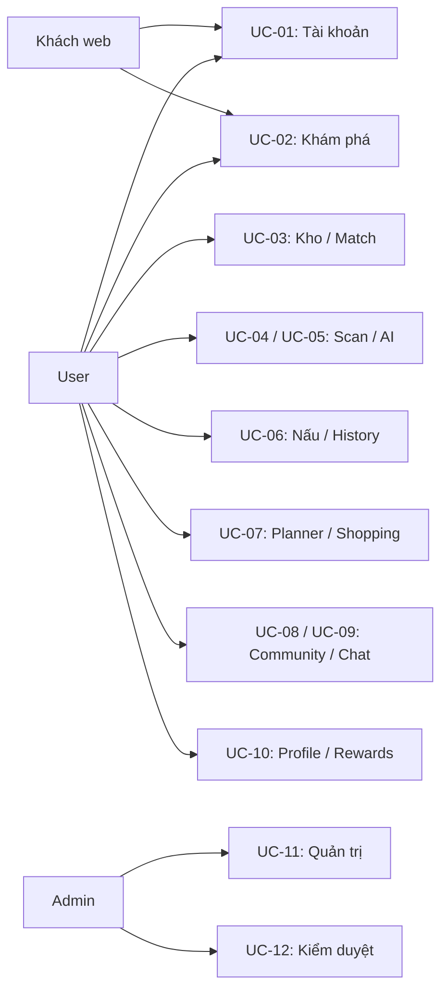

### 5.2 UC-01 — Đăng nhập và khảo sát

**Tiền điều kiện:** Backend sẵn sàng; có account hoặc đăng ký mới. **Kích hoạt:** Chọn login. **Hậu điều kiện:** Có phiên hợp lệ, mở đúng màn hình.

1. User nhập email/password hoặc chọn Google.
2. Client validate, gửi auth request.
3. Backend kiểm tra thông tin/trạng thái, cấp tokens.
4. Client lưu tokens/profile, cập nhật phiên.
5. Mobile mở Home nếu survey hoàn tất; ngược lại mở survey.
6. User lưu hoặc bỏ qua survey rồi vào Home.

**Ngoại lệ:** Sai dữ liệu/credentials/khóa account không tạo phiên; lỗi mạng giữ form để thử lại; hủy OAuth không tạo dữ liệu giả. Mobile đăng ký thành công quay về login.

**Hình 6. Sequence đăng nhập mobile.**

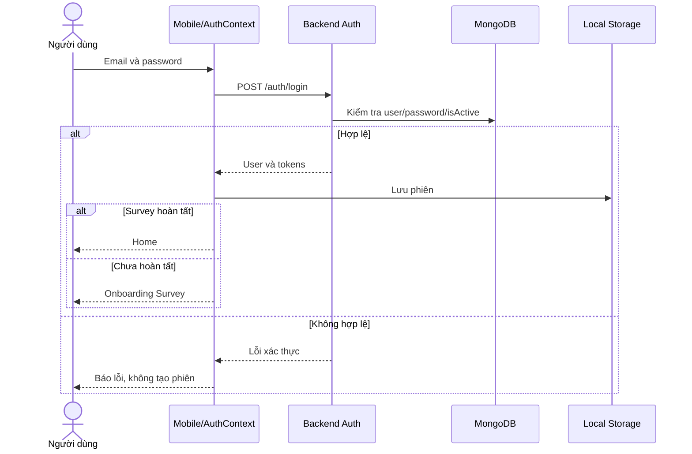

### 5.3 UC-02/UC-03 — Khám phá và kho

**Tiền điều kiện:** Recipe tồn tại; kho/favorite cần phiên. **Hậu điều kiện:** Recipe/kho/match đúng user.

1. User mở Explore, chọn search/filter hoặc mở Fridge.
2. Client tải recipe/kho/danh mục.
3. User CRUD nguyên liệu; server lưu UserFridge riêng.
4. Yêu cầu fridge-match; server chuẩn hóa tên/alias, tính và xếp điểm.
5. UI hiển thị món, nguyên liệu có/thiếu; user mở detail, favorite hoặc Cooking Mode.

**Ngoại lệ:** Không có kết quả hiển thị empty state; ghi kho lỗi không báo đã lưu; recipe thiếu không giả là bản ghi thật. Khớp tên không đảm bảo đủ lượng cho mọi khẩu phần.

### 5.4 UC-04 — Scan và xác nhận kho

**Tiền điều kiện:** Login; ảnh hợp lệ; quyền khi cần. **Hậu điều kiện:** Có scan history; item được chọn vào kho nếu API thành công.

1. User chụp/chọn ảnh; client upload multipart.
2. Backend upload media, gọi Gemini và lưu ScanHistory.
3. UI hiển thị ảnh, ingredients/pins và suggestion.
4. User kiểm tra, chọn các nguyên liệu muốn thêm.
5. Client gửi item vào kho, tải lại kết quả.

**Ngoại lệ:** Hủy/từ chối quyền không upload; file lớn/sai định dạng bị từ chối; provider lỗi hiển thị lỗi hoặc fallback có nhãn. Code hiện có mẫu confidence/ingredients; G-03 là điều kiện cần hoàn thiện, không coi confidence là accuracy đã đo.

**Hình 7. Sequence scan và xác nhận kho.**

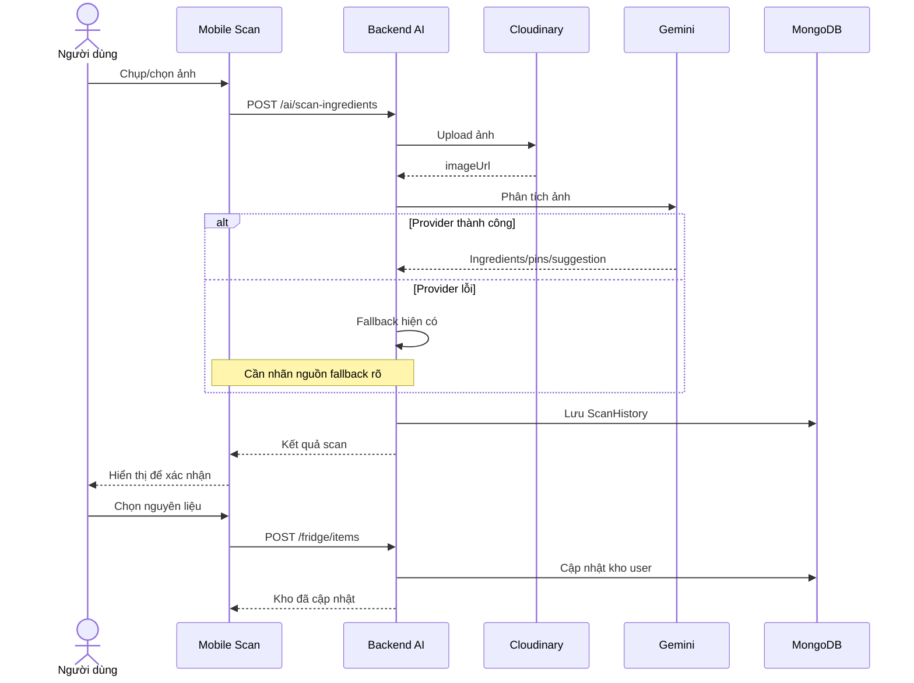

### 5.5 UC-05 — Trợ lý AI

**Tiền điều kiện:** Phiên hợp lệ, câu hỏi có nội dung. Client gửi message/history; backend lấy kho/preferences user, gọi provider và trả replyText/suggestedDishes/quickPrompts; UI thêm câu trả lời. Lỗi phải kết thúc pending và cho thử lại. Hội thoại AI trong component là local state; chưa có collection lưu toàn bộ AI chat. **Hậu điều kiện:** Câu trả lời hoặc thông báo lỗi được hiển thị, không sửa kho tự động.

### 5.6 UC-06 — Cooking và history

**Tiền điều kiện:** Recipe có bước nấu. **Hậu điều kiện:** History/XP được server xác nhận hoặc thoát mà chưa ghi hoàn thành.

1. User bắt đầu nấu; UI hiển thị bước X/Y.
2. User chuyển bước, điều khiển timer, bật/tắt TTS.
3. Timer về 0 phản hồi trong app; user quyết định bước tiếp theo.
4. User xác nhận hoàn thành và rating nếu có.
5. Client gửi recordCooking; backend ghi history, cập nhật XP/level.
6. UI dùng response để cập nhật history/profile.

**Ngoại lệ:** Thoát chưa hoàn thành không tự ghi; API lỗi không báo đã lưu; test gửi lặp/lỗi giữa bước ghi XP và history. Timer hết không đồng nghĩa món đã nấu xong.

**Hình 8. State timer; ghi hoàn thành là thao tác riêng.**

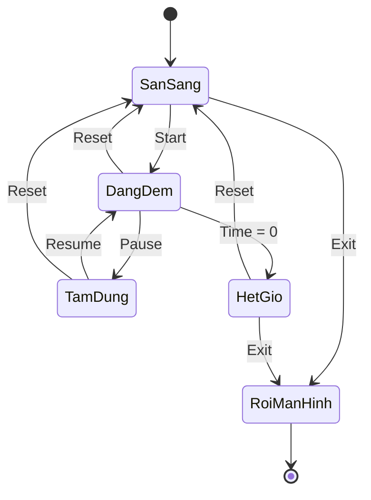

Luồng lưu: Confirm finish → POST cooking-history → server success → history/XP UI. Timer hiện không bảo đảm hoạt động khi app bị OS đóng/dừng nền.

### 5.7 UC-07 — Planner, shopping và sync

**Tiền điều kiện:** Login. **Hậu điều kiện:** MealPlan/CartItem/Kho được cập nhật qua API.

1. Tải/tạo tuần chuẩn hóa về thứ Hai.
2. Chọn ngày/slot/recipe hoặc custom title rồi lưu.
3. Xem meals và calories; mở shopping list.
4. Backend gom tên ingredients từ recipe slots, loại tên khớp kho, upsert cart.
5. User thêm/xóa/toggle bought.
6. Sync các mục bought chưa synced; backend thêm kho, đánh dấu synced.
7. UI hiển thị syncedCount, tải lại dữ liệu.

**Ngoại lệ:** Custom title không có recipe không tự sinh ingredients; recipe thiếu bị từ chối; không có item đủ điều kiện trả 0. Lượng/giá ước tính; chưa quy đổi đơn vị hoặc trừ lượng tồn chính xác.

**Hình 9. Flow planner–shopping–fridge.**

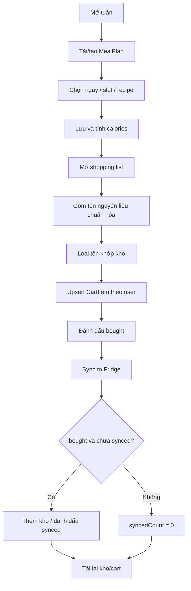

### 5.8 UC-08/UC-09 — Community và chat

**Tiền điều kiện:** Login để ghi nội dung/chat. **Hậu điều kiện:** Nội dung/tin thật lưu và hiển thị đúng quyền.

User tạo post/ảnh; backend gắn author và lưu. React/comment cập nhật theo response. Saved post mobile hiện chỉ toggle memory, không phải server bookmark. Report phải có target và reason; backend validate, admin xử lý.

Chat direct: get-or-create bằng targetUserId → conversationId thật → join room → tải history → send message. Gateway kiểm tra quyền, service lưu Message, phát new_message; client loại trùng ID. Mất socket có REST fallback nếu mạng vẫn hoạt động. Local fallback không được coi là tin đã gửi bền vững.

**Hình 10. Sequence chat và kiểm tra quyền.**

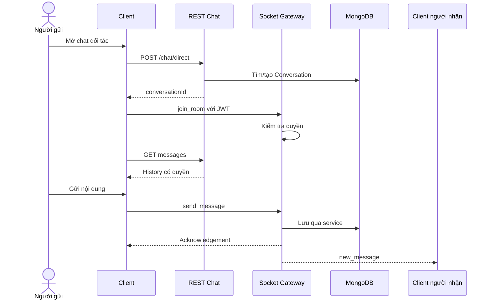

### 5.9 UC-10 — Profile, notification và rewards

**Tiền điều kiện:** Login. User tải profile/reward status; sửa thông tin; đọc/xóa notification. Check-in kiểm tra ngày; redeem kiểm tra rewardId và XP trước khi trừ/lưu claimedReward. **Hậu điều kiện:** UI phản ánh response thật. **Ngoại lệ:** Điểm danh trùng/thiếu XP/reward sai bị từ chối; không hiển thị redeem success khi chỉ cập nhật local. Bảng level khác nhau giữa service là OI-02.

### 5.10 UC-11/UC-12 — Admin và moderation

**Tiền điều kiện:** Phiên admin, target tồn tại. Admin tải dữ liệu, CRUD hoặc đổi trạng thái/role qua API. Với report: xem report/target → chọn decision/action → server áp dụng target → lưu status/resolvedBy/resolvedAt/notes. **Hậu điều kiện:** API success và reload xác nhận thay đổi. **Ngoại lệ:** 401/403/404 hoặc action lỗi không báo đã hoàn tất; test ban/action_taken từng target độc lập.

**Hình 11. Flow kiểm duyệt report.**

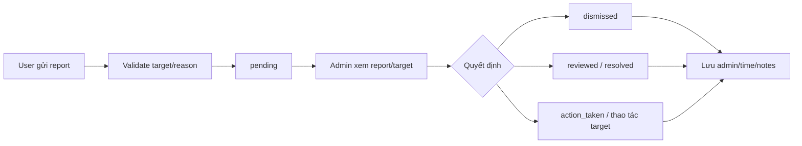

## 6. Dữ liệu và ERD

### 6.1 Nguyên tắc mô hình

Source backend có 18 model tương ứng collection trong ERD hiện có. Đây là đối chiếu source, không phải xác minh database production. PK là ObjectId; FK là logical link/Mongoose ref, không phải SQL foreign key được database cưỡng chế.

Recipe.ingredients/steps/nutrition, Fridge.items, MealPlan.days/meals, Post.reactions, Conversation.participants/members và User.preferences/checkIn/claimedRewards là dữ liệu nhúng. DTO/state mobile/web không tạo thêm collection. ERD chia ba hình để dễ đọc; User lặp lại là cùng một thực thể.

### 6.2 Nhóm bếp

**Hình 12. Recipes, inventory, planner và shopping.**

```mermaid
erDiagram
    USERS {
        ObjectId _id PK
        string email UK
        string role
        object preferences
    }
    CATEGORIES {
        ObjectId _id PK
        string code UK
    }
    INGREDIENTS {
        ObjectId _id PK
        string name
        string category "enum or matching code"
        object aliases
    }
    RECIPES {
        ObjectId _id PK
        ObjectId authorId FK
        string categoryCode FK
        object ingredients
        object steps
        object nutrition
    }
    USERFRIDGES {
        ObjectId _id PK
        ObjectId userId FK, UK
        object items
    }
    COOKING_HISTORIES {
        ObjectId _id PK
        ObjectId userId FK
        ObjectId recipeId FK
        number xpEarned
    }
    MEALPLANS {
        ObjectId _id PK
        ObjectId userId FK
        datetime weekStartDate "unique with userId"
        object days
    }
    CARTITEMS {
        ObjectId _id PK
        ObjectId userId FK
        ObjectId recipeId FK "optional"
        boolean bought
        boolean syncedToFridge
    }
    USERS o|--o{ RECIPES : authors
    USERS }o--o{ RECIPES : favorites
    CATEGORIES o|--o{ RECIPES : categoryCode
    CATEGORIES o|--o{ INGREDIENTS : logical_code_when_matching
    USERS ||--o| USERFRIDGES : owns
    INGREDIENTS o|--o{ USERFRIDGES : referenced_in_items
    USERS ||--o{ COOKING_HISTORIES : records
    RECIPES o|--o{ COOKING_HISTORIES : logical_recipe_ref
    USERS ||--o{ MEALPLANS : plans
    RECIPES }o--o{ MEALPLANS : embedded_recipe_refs
    USERS ||--o{ CARTITEMS : owns
    RECIPES o|--o{ CARTITEMS : source
```

UserFridge có thể tạo lười nên user có 0/1 kho. History hiện chấp nhận recipe mock, có thể gán ObjectId thiếu đích; recipe link không được coi là toàn vẹn cưỡng chế, xem G-10. Ingredient.category không bắt buộc tồn tại Category document.

### 6.3 Nhóm cộng đồng

**Hình 13. Posts, chat và report.**

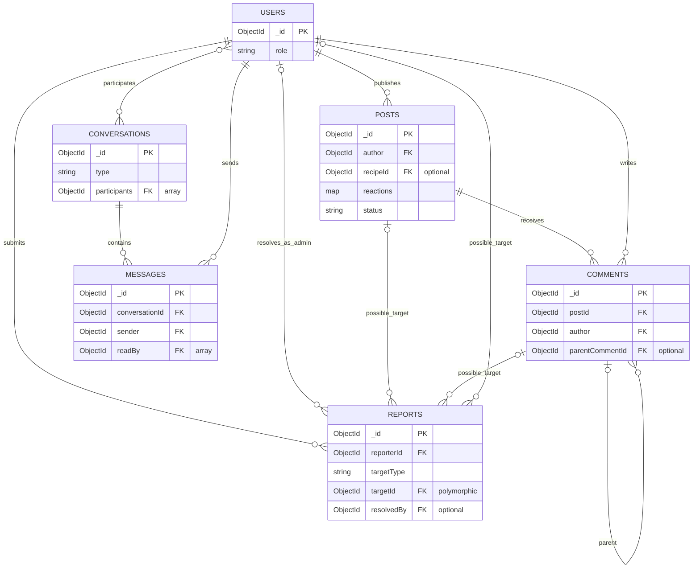

Report target là một post/comment/recipe/user tùy targetType; cạnh possible_target không yêu cầu có tất cả. Recipe là target ngoài hình này.

### 6.4 Nhóm hỗ trợ

**Hình 14. OTP, scan, notification và dữ liệu tham chiếu.**

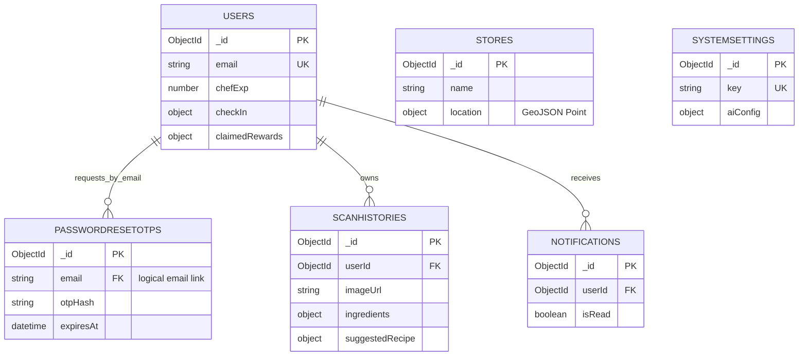

Stores/SystemSettings độc lập, không gán user FK giả. Reward catalog khai báo trong service; claimedRewards/checkIn nhúng User, không có collection Rewards riêng.

### 6.5 Từ điển dữ liệu

| Collection/model | Dữ liệu và liên kết | Ràng buộc/lưu ý |
|---|---|---|
| users / User | Profile, authType, role, preferences, XP, favorite IDs, checkIn/rewards, refreshToken. | Email unique; băm password; không trả secret trong public profile. |
| passwordresetotps / PasswordResetOtp | Email/hash/expiry/used/attempts. | TTL; vẫn kiểm tra hạn lúc sử dụng. |
| categories / Category | Code/name/icon/order/active. | Code unique, liên kết chuỗi. |
| ingredients / Ingredient | Tên chuẩn hóa/alias/category/unit/averagePrice. | Enum category; không ép ref SQL. |
| recipes / Recipe | Author, ingredient/step/nutrition, tags/rating/time/status. | AuthorId có thể thiếu ở seed; soft delete. |
| userfridges / UserFridge | User và item nhúng. | Một kho/user; ingredientId item tùy chọn. |
| cooking_histories / CookingHistory | User/recipe/snapshot/time/rating/XP. | Owner; index user/cookedAt. |
| scanhistories / ScanHistory | User/ảnh/ingredients/pins/suggestion/time. | Suggestion snapshot có thể không trỏ recipe thật. |
| mealplans / MealPlan | User/tuần/days/meals. | Unique userId + weekStartDate. |
| cartitems / CartItem | User/name/amount/price/recipe/bought/synced. | Backend cart theo user, khác local cart. |
| posts / Post | Author/media/caption/recipe/reactions/counters/status. | Owner/admin; soft delete. |
| comments / Comment | Post/author/parent/content. | Parent tùy chọn; soft delete. |
| conversations / Conversation | Direct/room, participants/members/summary. | Membership trước read/send/join. |
| messages / Message | Conversation/sender/text/image/readBy/time. | Sender theo phiên. |
| reports / Report | Reporter/target/reason/status/resolution. | Đa hình; xử lý admin. |
| notifications / Notification | User/title/body/type/data/read. | Giới hạn truy vấn user. |
| stores / Store | Address/phone/location/active. | GeoJSON longitude, latitude; không có stock/price live. |
| systemsettings / SystemSetting | Key/app/provider/aiConfig. | Key unique; admin API. |

### 6.6 Vòng đời dữ liệu

User/Recipe/Post/Comment có soft delete; không suy ra mọi collection đều xóa mềm. History/scan/notification xóa theo endpoint/quyền. Date lưu dạng Date/ISO, UI định dạng lại; mapping id/_id phải giữ đúng bản ghi. Chưa có UserBehavior collection/retention 90 ngày để công bố. Backup/restore/retention ảnh/xóa tài khoản cần chốt vận hành riêng.

## 7. Giao diện và tích hợp

### 7.1 Màn hình mobile

| Màn hình/view | Nội dung | Trạng thái cần có |
|---|---|---|
| Welcome/Auth | Splash, login/register/Google, survey/Home. | Session loading, validation, auth/network error. |
| Survey | Sáu nhóm preferences, save/skip. | Lựa chọn đã lưu, pending/error. |
| Home/Explore | Quick actions, category, search/list. | Loading/empty/error/sample. |
| Recipe Detail/Create | Ingredient/steps/nutrition/favorite/cart/cooking, create. | Not found, save/upload error. |
| Cooking Mode | X/Y, timer, TTS, finish. | Ready/running/paused/expired; history save error. |
| FridgeView | Kho, CRUD, match, thiếu nguyên liệu. | Empty/expiry/save error. |
| Scan/History | Camera/library, result/selection/history. | Permission/upload/AI/fallback/error. |
| Planner/Shopping | Ngày/slot/recipe/calories/cart/sync. | Empty/pending/no items/error. |
| Community/Chat | Feed/post/comment/direct/room. | Pending/sent/failed/disconnected. |
| Profile/Rewards | User/survey/history/XP/rewards/logout. | Loading/save error/insufficient XP/duplicate check-in. |
| Notification | List/banner/read/delete/count. | Empty/unread/realtime/error. |

Route mobile ở src/app/(auth), src/app/(main). Fridge/Planner/Community/Profile/Scan là feature views nhúng trong Home. Modal nằm trong nhóm components tương ứng, không gom tất cả vào common như bản cũ.

### 7.2 Web routes

Public: /, /showcase, /recipes, /recipes/:id, /my-kitchen, /scan, /community và alias trong AppRoutes. /profile dùng ProtectedUserRoute. /admin/* dùng AdminLayout role guard: dashboard/dishes/community/ai-engine/users/marketing/supermarkets/settings. Route tồn tại không chứng minh mọi action trên page có persistence.

### 7.3 REST interface

Base path **/api/v1**. API riêng dùng Authorization: Bearer accessToken. Response thường có success/message/data; pagination phụ thuộc endpoint, có thể nằm trong data. Không ép mọi endpoint cùng DTO/envelope.

| Nhóm | Endpoint đại diện | Quyền |
|---|---|---|
| Auth | POST /auth/register, /login, /google, /refresh-token | Public + rate limit/validate. |
| OTP | POST /auth/forgot-password, /verify-otp, /reset-password | Public + rate limit/validate. |
| Profile | GET /auth/me; PUT /auth/profile; POST /auth/survey, /logout | User. |
| Reference | GET /categories, /ingredients, /stores, /stores/nearby | Public; CRUD reference admin. |
| Recipe read | GET /recipes, /recipes/trending, /recipes/:id | Public/optional auth. |
| Recipe action | GET /recipes/fridge-match; POST /recipes/:id/favorite; POST/PUT/DELETE recipes | User; update/delete owner/admin. |
| Fridge | GET /fridge; POST /fridge/items; PUT/DELETE /fridge/items/:itemId; DELETE /fridge/clear | User riêng. |
| History | GET/POST /cooking-history; DELETE /cooking-history/:id | User; owner/admin khi xóa. |
| AI | POST /ai/scan-ingredients, /assistant-chat; GET /ai/scan-history; DELETE /ai/scan-history/:id | User. |
| Planner | GET /planner/current-week; PUT/DELETE /planner/meals | User. |
| Shopping | GET/POST /planner/shopping-list; PATCH /planner/shopping-list/:id/bought; DELETE /planner/shopping-list/:id, /clear-bought; POST /planner/sync-to-fridge | User. |
| Community | GET/POST /posts và /community/posts; POST /:id/react, /like, /comments; GET /:id/comments | Read public; write user. |
| Moderation post | DELETE /posts/:id; PATCH /posts/:id/pin, /status | Owner/admin hoặc admin theo nghiệp vụ. |
| Chat | GET /chat/rooms, /conversations; POST /chat/direct; GET/POST /chat/conversations/:id/messages | User + hội thoại access. |
| Notifications | GET /notifications; PATCH /notifications/read-all, /:id/read; DELETE /:id | User. |
| Rewards | GET /rewards/status; POST /rewards/check-in, /redeem | User. |
| Reports | POST /reports; GET /reports, /reports/:id; PATCH /reports/:id | User gửi; admin đọc/xử lý. |
| Admin | /admin/dashboard, /users, /reports, /settings, /ai-engine/config, /ai-engine/status; status/role/settings/config/report updates | Admin. |
| System | GET /health; Swagger /api-docs ngoài base path | Theo config. |

Path viết rút gọn trong cùng dòng kế thừa tiền tố của nhóm. Mã lỗi: 400 invalid, 401 unauthorized, 403 forbidden, 404 missing, 409 conflict nếu endpoint dùng, 429 rate limit, 5xx server/provider. UI phải phân biệt lỗi, empty và sample.

### 7.4 Socket và thiết bị

Socket.IO client gửi auth.token, dùng websocket/polling: join_room, leave_room, send_message, new_message, typing/user_typing, stop_typing/user_stop_typing, new_notification. Backend hiện cho token thiếu/sai xuống chế độ guest cho realtime công khai; quyền đọc/gửi/join hội thoại riêng vẫn phải được kiểm tra. Reconnect join lại và tải history; socket không thay database persistence. User notification qua room riêng.

expo-image-picker cho camera/library; expo-location cho GPS/reverse geocode; expo-speech cho TTS; expo-haptics cho phản hồi; Linking mở map. Chỉ xin quyền khi dùng chức năng. Middleware image tối đa 5 MB/ảnh; post tối đa 5 ảnh; MIME JPEG/JPG/PNG/WebP/GIF.

## 8. Yêu cầu phi chức năng

Ngưỡng hiệu năng là mục tiêu nghiệm thu đề xuất, chưa benchmark. Nhóm phải chốt máy, dataset, thiết bị và ngưỡng trước khi phê duyệt.

| Mã | Yêu cầu/mục tiêu | Kiểm chứng |
|---|---|---|
| NFR-001 | Production API/realtime phải HTTPS/WSS. | URL/TLS/traffic deployment; HTTP dev không tính đạt. |
| NFR-002 | API kiểm tra JWT/role/owner độc lập UI. | Không token, user khác, role user/admin: 401/403 hoặc không lộ dữ liệu. |
| NFR-003 | Băm password/OTP; không lộ secret ở bundle/docs/log public. | Model/response/log/artifact audit. |
| NFR-004 | Native tokens dùng SecureStore; logout/refresh lỗi xóa phiên. | Login/restart/logout/thu hồi token và kiểm tra guard/storage. |
| NFR-005 | API không AI/upload: p95 ≤2 giây, 20 phiên đồng thời trong 10 phút. | Load test ghi cấu hình/dataset/cache hit-miss/error; chưa đo. |
| NFR-006 | Client hiển thị pending và kết thúc khi response/error/timeout. | Slow/offline; không tạo request lặp vô ý; mobile Axios default 15 giây, scan timeout riêng. |
| NFR-007 | Provider/upload lỗi không crash hoặc báo mẫu như thật. | Provider down/quota/image invalid; nhãn fallback/error/retry. |
| NFR-008 | Server-success data còn sau restart/re-query. | ID thật; reset client cache; không áp dụng cho sample cart memory. |
| NFR-009 | Chat reconnect không trùng và tải được missed history. | Hai client, network loss/reconnect, so message ID/count. |
| NFR-010 | Permission denial/empty/network error có phản hồi dễ hiểu. | Camera/GPS denial, empty data và 4xx/5xx. |
| NFR-011 | Test ít nhất 1 Android, 1 iOS; web Chrome/Edge, desktop/mobile viewport. | Ghi OS/browser/viewport và kết quả, không suy ra mọi OS đều đạt. |
| NFR-012 | Có backup/restore MongoDB chạy thử trước production. | Lịch/nơi lưu/quyền/restore test; RPO/RTO chốt OI-05. |
| NFR-013 | Release qua build/typecheck và AT cốt lõi. | Commit/lệnh/time/env/result; script tồn tại không đồng nghĩa pass. |
| NFR-014 | Kiểm tra consistency khi history/XP/redeem/sync lỗi/gửi lặp. | Fault injection/concurrency/retry; không tự khẳng định atomic/exactly-once. |
| NFR-015 | Nút/icon có nhãn; trạng thái không chỉ dựa vào màu. | Screen reader/chữ lớn/error UI trên màn hình chính. |

## 9. Quy tắc nghiệp vụ

| Mã | Quy tắc |
|---|---|
| BR-001 | Backend xác nhận danh tính/role. Admin là User role admin; client không tự gán quyền. |
| BR-002 | Preferences là ngữ cảnh gợi ý, không chứng nhận an toàn dị ứng. |
| BR-003 | Match = round(matched/total ×100), 0 nếu total=0; so tên chuẩn hóa/alias; điểm rồi rating giảm dần. Service không bắt buộc ngưỡng 60%. |
| BR-004 | Shopping gom tên, loại tên khớp kho; lượng chuỗi, chưa quy đổi/trừ định lượng. Cart theo user, không tự có cart riêng/tuần. |
| BR-005 | MealPlan unique user + Monday weekStartDate, 7 ngày/4 slot. Custom title không có recipeId không tự sinh ingredients. |
| BR-006 | Sync chỉ bought=true, synced=false; đánh dấu sau thêm. Concurrency kiểm tra theo NFR-014. |
| BR-007 | Cooking history success hiện +50 XP; cần test chống lặp/lỗi giữa bước; delete history không mặc nhiên hoàn/trừ XP. |
| BR-008 | Timer về 0 hoặc planner isCooked không tự tạo history; cần confirm và response riêng. |
| BR-009 | Check-in một lần theo ngày server hiện UTC; streak chu kỳ 7 ngày; chốt timezone trước nghiệm thu. |
| BR-010 | Redeem phải có reward/đủ XP; claimedRewards nhúng User; voucher nội bộ khi chưa có partner. |
| BR-011 | Report target post/comment/recipe/user phải tồn tại; user gửi, admin xử lý và lưu audit fields. |
| BR-012 | Chat kiểm tra hội thoại access; sender theo phiên, không tin senderId tự khai. |
| BR-013 | Email unique; profile hiện sửa họ/tên/avatar; đổi email/password khi login cần luồng riêng. |
| BR-014 | Cost/calories/confidence là tham khảo; sample/estimate/real phải phân biệt. |
| BR-015 | Trending hiện rating; không công bố học máy/views/saves/cooks nếu chưa có thuật toán/dữ liệu. |

## 10. Kiểm thử và nghiệm thu

### 10.1 Điều kiện kiểm thử

Dùng DB test, tài khoản guest/user A/user B/admin, MongoDB ID thật và dataset xác định. Ghi provider thật/mock có nhãn. Không dùng dish-1, mẫu confidence hoặc KPI hardcode để kết luận persistence/accuracy.

### 10.2 Kịch bản

| Mã | Kịch bản và kết quả cần đạt |
|---|---|
| AT-01 | Register hợp lệ/trùng email/thiếu field/password sai; mobile về login, account thật. |
| AT-02 | Login/restart/concurrent refresh/revoked token/logout/locked account; không truy cập riêng khi phiên invalid; survey/profile reload. |
| AT-03 | Search/filter/page/detail/favorite/create; reload ID thật; user B không sửa/xóa recipe A. |
| AT-04 | Kho CRUD; 2/4 match=50%; điểm bằng so rating; empty; user B denied. |
| AT-05 | Step/timer/pause/reset/TTS/finish/history; lỗi server, gửi lặp và consistency XP. |
| AT-06 | Camera/library/permission denial/>5MB/provider thật-lỗi/AI chat; phân biệt fallback; add fridge và delete history. |
| AT-07 | Tuần/slot/calories/shopping/name exclusion/bought/sync; sync lại tuần tự không thêm cùng mục. |
| AT-08 | Post/images/react/comment/reply/send error/report valid-invalid; reload persistence; saved local không tính bookmark server. |
| AT-09 | Hai client chat/history/typing/reconnect/REST; user ngoài conversation denied; không trùng message. |
| AT-10 | Notification read/delete/count/realtime; duplicate check-in; redeem thiếu/đủ XP; ngày UTC và level consistency. |
| AT-11 | User admin API→403; CRUD/lock/role; report action từng target; settings reload; KPI mẫu có nhãn. |
| AT-12 | OTP đúng/sai/hết hạn/đã dùng/attempt limit/reset; API hiện có, UI nghiệm thu sau tích hợp. |
| AT-13 | NFR: TLS/quyền/performance/network/provider/devices/accessibility/backup/consistency. |

### 10.3 Công cụ và biên bản

Backend có build/E2E phases/security/admin/cache scripts; mobile có type-check/lint/E2E; web có build/lint/integration/chat/community scripts. Đây là danh mục source, không ghi nhận các suite đã pass trong lần biên soạn này.

Biên bản phải ghi AT/NFR, commit/build, môi trường, bước, expected/actual, bằng chứng, pass/fail và issue. Chỉ chức năng kiểm thử dữ liệu thật mới ghi “đã đạt”. Yêu cầu một phần/đề xuất phải được chốt hoàn thiện hoặc đưa ra khỏi baseline trước nghiệm thu.

## 11. Ma trận truy vết

B/M/W = backend/mobile/web. Đường dẫn nêu bằng chứng chính, không phải mọi file.

| Yêu cầu | Use case / kiểm tra | Source chính | Trạng thái |
|---|---|---|---|
| FR-001–FR-002 | UC-01 / AT-01–02 | B auth.route/auth.service; M app/(auth)/AuthContext; W pages/auth | Có mã nguồn. |
| FR-003 | UC-01 / AT-02 | B auth.service; M login; W OAuth/login | Có mã nguồn; cần provider config. |
| FR-004–FR-005 | UC-01 / AT-02 | M apiClient/tokenStorage; W api/client/useAuthStore; B auth.service | Có mã nguồn. |
| FR-006 | UC-01 / AT-12 | B auth.route/validator/service/PasswordResetOtp; M handleForgotPassword | Một phần: OTP backend; mobile Alert. |
| FR-007–FR-008 | UC-01/10 / AT-02 | M survey/Profile/EditProfile/AuthContext; B survey/profile | Có mã nguồn; kiểm tra skip/avatar. |
| FR-009–FR-011 | UC-02 / AT-03 | M home/explore/detail; W RecipeList/Detail; B recipe repository | Có mã nguồn; chỉ filter API hỗ trợ. |
| FR-012–FR-013 | UC-02 / AT-03 | B recipe route/service/User; M CreateRecipe; W DishManagement/recipe.api | Có mã nguồn; mock ID không chứng minh lưu. |
| FR-014–FR-015 | UC-03 / AT-04 | B fridge/recipe services; M FridgeView; W MyKitchen | Có mã nguồn. |
| FR-016–FR-017 | UC-03/02 / AT-04 | M FridgeView; B getTrending | Một phần: expiry UI; trending rating, chưa expiry push job. |
| FR-018–FR-021 | UC-04/05 / AT-06 | B ai service/routes/ScanHistory; M ScanAI/ScanHistory/Assistant; W AIScan/Assistant | Có mã nguồn; fallback labeling thiếu. |
| FR-022–FR-024 | UC-06 / AT-05 | M cooking-mode.tsx | Có mã nguồn mobile; chưa chứng minh chạy nền. |
| FR-025–FR-026 | UC-06 / AT-05 | B cookingHistory service/repository; M historyService/Modal; W history.api/Profile | Có mã nguồn; consistency cần test. |
| FR-027–FR-031 | UC-07 / AT-07 | B planner route/service/repository/models; M PlannerView/service; W planner.api | Có code backend/mobile; không khẳng định web UI parity. |
| FR-032 | UC-07 / AT-07 | B store service/model; M storeService; W NearbySupermarkets | Có mã nguồn, location/sample fallback. |
| FR-033–FR-034 | UC-08 / AT-08 | B community; M CommunityService/modals; W CommunityPage | Có mã nguồn; fallback/local cần phân biệt. |
| FR-035 | UC-08/12 / AT-08/11 | B report; W community.api/moderation | Một phần: chưa thấy mobile report flow đủ. |
| FR-036–FR-038 | UC-09 / AT-09 | B chat/gateway; M socket/CommunityService; W chatStore/socket | Có mã nguồn; test access/reconnect hai client. |
| FR-039–FR-040 | UC-10 / AT-10 | B notification; M service/Modal/Banner | Có code backend/mobile; in-app, không OS push. |
| FR-041–FR-042 | UC-06/10 / AT-05/10 | B cookingHistory/reward services; M reward/profile | Có mã nguồn; level khác nhau. |
| FR-043–FR-044 | UC-11 / AT-11 | B admin; W AdminLayout/Dashboard | Một phần: guard/API có; KPI mẫu/ước tính. |
| FR-045–FR-047 | UC-11/12 / AT-11 | B admin/report/reference; W admin pages | Có mã nguồn; vài action local/report branch cần test. |
| FR-048 | UC-11 / AT-11 | B systemSetting; W Settings/AIEngine | Một phần: save/config có; runtime effect cần kiểm tra. |
| NFR-001–NFR-015 | AT-13 và AT liên quan | Middleware/storage/config/scripts và đo thực tế | Mục tiêu, chưa benchmark/nghiệm thu. |

## 12. Giới hạn và hướng mở rộng

### 12.1 Khoảng cách quan sát

| Mã | Phát hiện | Tác động |
|---|---|---|
| G-01 | Forgot password mobile chỉ Alert, backend OTP có. | Chưa nghiệm thu reset mobile end-to-end. |
| G-02 | Mobile cart memory, web cart localStorage theo user, planner cart MongoDB. | Chưa đồng bộ một cart xuyên client. |
| G-03 | AI scan fallback trả ingredients/confidence mẫu. | Cần nhãn nguồn; không coi là accuracy đo hoặc kết quả thật. |
| G-04 | Planner tuần, shopping loại theo tên. | Không tuyên bố tối ưu 14 ngày/ngân sách/trừ lượng. |
| G-05 | Notifications DB/Socket; timer local. | Không có bằng chứng OS push/scheduled jobs/background timer. |
| G-06 | Cooking/reward dùng bảng level khác nhau. | Thống nhất rule và kiểm tra mọi nguồn XP. |
| G-07 | Dashboard có số cố định/ước lượng. | Phân biệt mẫu/estimate/real. |
| G-08 | Marketing schedule/hero/approval có local Zustand actions. | Chưa coi là scheduler/persistence workflow. |
| G-09 | Recipe search truyền thống, trending rating. | Chưa có self-learning recommendation/NLP parser. |
| G-10 | History recipe mock có thể thiếu bản ghi đích. | Không coi FK bảo đảm; test missing/deleted recipe. |
| G-11 | History/XP/redeem/sync nhiều bước ghi. | Test fault/concurrency/retry trước khẳng định atomicity. |
| G-12 | Sơ đồ cũ có nhãn mạnh hơn bằng chứng source. | SRS dùng bản rút gọn đối chiếu; giữ sơ đồ gốc cho rà soát. |

### 12.2 Đối chiếu 25 module bản nguồn

| Module cũ | Giữ trong SRS | Hướng mở rộng / phần cần hoàn thiện |
|---|---|---|
| 1. Authentication | FR-001–FR-006, FR-008 | Reset UI, đổi email/password riêng. |
| 2. Onboarding | FR-007 | Không bảo đảm an toàn dị ứng tự động. |
| 3. Home | FR-009, FR-017 | Personalization tự học. |
| 4. Categories | FR-010, FR-045 | Subcategories theo dữ liệu thật, không cố định tùy ý. |
| 5. Recipe | FR-011–FR-013 | Không ép prep/cook tách riêng khi DTO thiếu. |
| 6. Fridge | FR-014–FR-015 | Không ngưỡng 60% bắt buộc/đủ lượng. |
| 7. Scan AI | FR-018–FR-020 | Fallback minh bạch, xác nhận kết quả. |
| 8. Recommendation | FR-015, FR-021 | Machine learning tương tác. |
| 9. Cooking | FR-022, FR-024–FR-025 | Không tự ghi hoàn thành. |
| 10. Timer | FR-023 | Background/OS push. |
| 11. Nutrition | FR-011, FR-028 | Daily goal/macros thực tế/sugar tracking. |
| 12. Planner | FR-027–FR-028 | Tối ưu tự động 14 ngày. |
| 13. Shopping | FR-029–FR-031 | Quy đổi lượng/scheduled reminder/cart sync. |
| 14. Inventory | FR-014, FR-016 | Scheduled expiry push. |
| 15. Cost | FR-011, FR-030 | Giá thị trường live/cost filter API. |
| 16. Personalization | FR-007, FR-021 | UserBehavior/self-learning. |
| 17. Rating/review | Rating FR-025, community FR-034 | Recipe review nhiều tiêu chí/ảnh riêng. |
| 18. History | FR-025–FR-026 | Không suy ra mọi UI filter/stat có API. |
| 19. Remix | Hỏi AI FR-021 | Version/remix/substitution có persistence. |
| 20. Trending | FR-017 | Xếp hạng views/likes/saves/cooks. |
| 21. NLP search | FR-010 | Dedicated parser NLP. |
| 22. Favorites | FR-012 | Custom collection/server saved posts. |
| 23. Push | FR-039–FR-040 | OS provider/device token/background delivery. |
| 24. AI generator | Suggestion/chat FR-019/21 | Endpoint tạo Recipe đầy đủ, validate/persist. |
| 25. Profile/settings | FR-008, FR-048 | Localization/help center/delete account. |

Community/chat, rewards/check-in và web admin được bổ sung FR-033–FR-048 vì bản 25 module cũ mô tả chưa đầy đủ.

### 12.3 Quyết định cần chốt

| Mã | Nội dung | Chủ thể |
|---|---|---|
| OI-01 | Baseline P1/P2 và mức parity mobile/web. | Nhóm/giảng viên |
| OI-02 | Bảng XP/level thống nhất; XP tích lũy hay được tiêu; redeem ảnh hưởng level. | Nghiệp vụ/backend |
| OI-03 | UTC hay Asia/Ho_Chi_Minh cho ngày điểm danh/tuần. | Nghiệp vụ/backend |
| OI-04 | Provider lỗi trả error hay demo có nhãn; dataset đo AI accuracy. | AI/QA |
| OI-05 | Deploy/TLS/runtime/DB/backup/retention/RPO/RTO. | Triển khai |
| OI-06 | Thiết bị/dataset/cấu hình tải và ngưỡng NFR. | QA |

## 13. Tham chiếu và sơ đồ

### 13.1 Nguồn

- [Bản SRS người dùng cung cấp](reference/SmartCook_SRS_user_source.txt).
- [Bản Markdown trước chỉnh sửa](reference/SmartCook_SRS_before_revision.md).
- [ISO/IEC/IEEE 29148:2018 — thông tin tiêu chuẩn](https://www.iso.org/standard/72089.html).
- [Expo SDK 57 reference](https://docs.expo.dev/versions/v57.0.0/).
- Backend: routes/controllers/services/repositories/models/validators/middlewares/socket và package.json.
- Mobile: app/components/contexts/services/types/tokenStorage/config và package.json.
- Web: AppRoutes/layouts/pages/store/api/socket.service và package.json.

### 13.2 Sơ đồ gốc đã đối chiếu

| Nhóm | File Mermaid | Vai trò |
|---|---|---|
| Ecosystem | [system_architecture](../../smartcook-backend/system_architecture.mermaid), [technologies_architecture](../../smartcook-backend/technologies_architecture.mermaid) | Bối cảnh/stack; nhãn production cần đối chiếu. |
| Backend | [backend_architecture](../../smartcook-backend/backend_architecture.mermaid) | Runtime/layers/providers. |
| Data | [erd_diagram](../../smartcook-backend/erd_diagram.mermaid) | 18 collection/model; không xác minh live DB lần này. |
| Actor data | [user_erd](../../smartcook-backend/user_erd.mermaid), [admin_erd](../../smartcook-backend/admin_erd.mermaid) | Actor conceptual, identity User. |
| Web | [web_architecture](../../smartcook-web/web_architecture.mermaid), [web_user_architecture](../../smartcook-web/web_user_architecture.mermaid), [web_admin_architecture](../../smartcook-web/web_admin_architecture.mermaid) | Kiến trúc user/admin; guard thực tế theo source. |
| Web DTO | [web_domain_erd](../../smartcook-web/web_domain_erd.mermaid) | DTO/state, không collection. |
| Mobile | [mobile_system_architecture](../mobile_system_architecture.mermaid), [mobile_domain_erd](../mobile_domain_erd.mermaid) | Mobile system và domain DTO/state. |

### 13.3 Bộ hình SRS

14 hình: context, system, mobile, web, use case, login sequence, scan sequence, timer state, planner flow, chat sequence, moderation flow và 3 ERD. Source Mermaid nằm trong diagrams; bản Word/PDF chèn hình render, không để placeholder “bổ sung ảnh”.

Phê duyệt baseline và xác nhận phần mềm đạt yêu cầu phải dựa trên rà soát/biên bản kiểm thử riêng. Lần biên soạn này hoàn thiện tài liệu, không thay thế nghiệm thu phần mềm.
